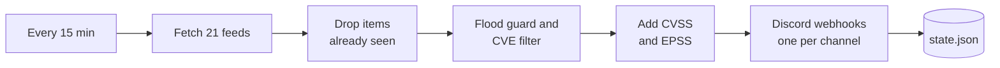

# How it works

The technical reference: every flag, what each run does, where state lives, running it without Docker, how dependencies are pinned and how tests run. To deploy it, see [deploy-docker.md](deploy-docker.md); for every variable and setting, [configuration.md](configuration.md).

- [Run without Docker](#run-without-docker)
- [Run](#run)
- [Schedule](#schedule)
- [State](#state)
- [Dependencies](#dependencies)
- [Test](#test)



Each run fetches every enabled feed (with conditional requests, so unchanged feeds cost almost nothing), finds items it has not seen, filters them, and posts each to its channel as a Discord embed. What it posted is saved in the state file for the next run. Each feed's format and quirks are in [feed-check.md](feed-check.md).

## Run without Docker

For development, or to run it from cron or systemd. Requires Python 3.12 or newer.

```bash
git clone <this repository's URL>
cd cyber-intel-discord-feeds
python3.12 -m venv .venv
source .venv/bin/activate
pip install -e '.[dev]'
```

On Debian or Ubuntu, `python3.12 -m venv` fails until you install `python3.12-venv`. If you use uv, `uv venv --seed --python 3.12 .venv` works without it.

Webhook URLs come from environment variables ([configuration.md](configuration.md)). Copy the template and fill in your own URLs:

```bash
cp .env.example .env
```

`.env` is gitignored. Never commit it or paste webhook URLs into issues, logs or chat: anyone holding one can post to the channel.

The job loads `.env` from the working folder when it exists, so no `source` step is needed. Variables already set in the shell (or passed in by Docker) win over the file; `--env-file PATH` reads another file. Logs and errors name the variable (`WEBHOOK_NEWS`), never the URL.

## Run

```bash
python -m intel_feeds --help
python -m intel_feeds            # one run: fetch, find new items, apply the flood guard and CVE filter, post
python -m intel_feeds --verbose  # with debug logging
python -m intel_feeds --check-config  # validate sources.yaml and exit
python -m intel_feeds --test-post     # post one sample embed to each webhook that is set
python -m intel_feeds --every 15m     # keep running: one run now, then every 15 minutes
python -m intel_feeds --health        # exit 0 if a run worked recently (for healthchecks)
```

Every run validates `sources.yaml` first and exits with code 2, listing every problem, if it is invalid. `--config PATH` reads another file.

The `settings:` section at the top of `sources.yaml` holds the job's limits: `cvss_min`, `cve_lookups_per_run`, `posts_per_channel`, `new_source_posts`, `max_age_days`, `keep_days`, the product watchlist (`watchlist`), which environment variable holds each channel's webhook (`webhooks`) and per-channel caps that differ from `posts_per_channel` (`channel_caps`). Each key is optional and is explained in the file; a missing key uses the default listed there, and the validation names the line and the setting for a bad value. A webhook variable with a new name goes in `.env` like the others.

A run posts each new item to its category's channel: `news` through `WEBHOOK_NEWS`, `vulns` through `WEBHOOK_VULNS`, `advisories` through `WEBHOOK_ADVISORIES`, `research` through `WEBHOOK_RESEARCH`, `ransomware` through `WEBHOOK_RANSOM`. Only sources of type `ransomware` may use the `ransomware` category, and they must. Items go out oldest first within each channel. An item is recorded in state only once its post succeeds. If a post fails, that channel stops for the run, and the run saves what did post and exits 1. The failed item and the ones after it post on the next run. A category whose webhook is not set keeps its items for a later run and logs a warning.

Each run ends with a summary table in the log, one line per enabled source plus a total: how the fetch went (`ok`, `not modified`, `failed` or `parse failed`), items parsed, new, filtered (held by the flood guard or the CVE filter), posted, left for the next run, errors, and seconds spent fetching and parsing. Then `run: finished in N s`, with a warning when a run takes more than 60 s (most runs take far less; a slow one usually means a slow source or a big backlog). NVD CVEs below the CVSS bar are not recorded, so they show as new and filtered again on each run while they stay in the query window.

Each run also tracks source health. A source whose fetch or parse fails is counted in state, and once it has been failing for 24 hours one "Source down" alert goes to the ops channel (`WEBHOOK_OPS`) with the latest error. When it works again (fetched and parsed, or answered 304), one "Source back" alert follows. A source that recovers within 24 hours recovers quietly, with a log line. An alert that cannot be posted is tried again on the next run; a failed alert post makes the run exit 1, while a missing `WEBHOOK_OPS` only logs a warning naming the waiting alerts.

Each channel posts at most 10 items a run (`posts_per_channel` in the settings); the ransomware channel posts up to 25 (`channel_caps`), since leak sites list victims in dumps. The oldest 10 go out; the rest stay unrecorded and go out on the next runs, oldest first, ahead of anything newer. Their sources are fetched in full until the overflow is gone. The log says `post WEBHOOK_…: N posted, M over the cap of 10 left for the next run`. A feed that lists only its latest items can drop an overflow item before it posts, so keep the cap above a channel's usual items per run.

Before routing, the flood guard holds back what must not post, and records it in state as seen but not posted:

- A **new source** (one whose backlog no run has taken in yet, including every source on the first run) posts only its 3 newest items from the last 7 days; the rest of its backlog is held back.
- On later runs, any new item **published more than 7 days ago** is held back (some feeds bring old advisories back).

Each run logs `flood guard: held back N (new source), M (older than 7 days)`. The limits are `new_source_posts` and `max_age_days` in the settings.

Then the CVE filter decides which vulnerability items post:

- Every new **CISA KEV** entry posts.
- An **NVD** CVE posts only if it scores CVSS 9.8 or higher (the score NVD lists at publish time) and KEV does not already have it. The rest are dropped without being recorded, which keeps about 1,250 CVEs a day out of state.
- **Product watchlist:** an NVD CVE below 9.8 still posts when its description names a product on `watchlist.products` in the settings and it scores `watchlist.min_cvss` (7.0) or more. Matching ignores case and needs whole words; links in the description are ignored. The post gets a `Watchlist` field naming the product. When one run lets through `watchlist.group_min` (3) or more CVEs for the same product, they post as one summary instead: the product and count as the title, the CVSS range, and the 15 highest-scoring CVEs with links and their own part of the description, then "+N more". The summary counts as one post toward the cap, and all its CVEs are recorded when it posts; the log says `post WEBHOOK_VULNS: one post for N "TeamCity" watchlist CVEs`. CVEs at 9.8 or higher still post one by one. The repo ships 31 products (Fortinet, SharePoint, NetScaler and others); empty the list to turn it off. MSRC and KEV are not affected.
- A source with `cve_filter: true` (Microsoft MSRC) posts an entry only if its CVE is in KEV or scores CVSS 9.8 or higher. Its feed has no scores, so each entry's CVE is looked up in NVD: one request each, paced for NVD's rate limit and capped at 20 a run with `NVD_API_KEY` set (4 without). Entries that fall short are recorded as not posted. An entry NVD cannot answer for yet, or that did not fit under the cap, is retried next run.

Each run logs `cve filter: N kept, N dropped, N held back, N deferred, N NVD lookups`, and when the watchlist let CVEs through, `cve filter: watchlist let through Fortinet 2, PAN-OS 1 (CVSS 7 to 9.8)`. The bar is `cvss_min` in the settings, and the lookups per run `cve_lookups_per_run`.

Just before posting, each CVE post (from KEV, NVD or a `cve_filter` source) that goes out this run gets an **EPSS** field: FIRST's probability that the CVE is exploited in the next 30 days and its percentile, for example `12.3% (96th percentile)`. All of a run's CVEs go in one request to the [FIRST EPSS API](https://www.first.org/epss/api) (no key needed). A CVE post with no CVSS score yet, such as a KEV addition, gets NVD's score through one lookup each, within the lookups the CVE filter left of `cve_lookups_per_run`. A CVE that FIRST or NVD has not scored yet posts without that field, and a failed request never stops a post. Each run logs `enrich: EPSS for N of M CVE posts, CVSS added to N from N NVD lookups`.

Each new CISA KEV entry mentions `@everyone` in the vulns channel: an exploited vulnerability is something every reader wants to know about. Only that post allows the mention; every other post allows none, so feed text containing `@everyone` can never ping anyone. MSRC entries with the KEV badge do not ping. The log says `post WEBHOOK_VULNS: N KEV entries pinged @everyone`.

The **ransomware.live** source (type `ransomware`) fetches the PRO API's 100 newest leak-site victims each run, sending the key from `RANSOMWARE_LIVE_API` in the `X-API-KEY` header. The API sends no ETag, so it is fetched in full every time (about 100 KB). Without the key the fetch fails at once and counts toward the source health alerts like any failed fetch; `--check-config` warns, naming only the variable. The key is never printed or logged. Each victim posts once, with no grouping and no ping: the victim name linking to its ransomware.live page, Group (linking to the group's page), Country (flag and name), Sector and Website when known, and up to 300 characters of the leak post's description. Posts never link to the leak site itself.

`POSTING_ENABLED` in `src/intel_feeds/__main__.py` is a switch to stop posting without stopping runs. With it off, the guard holds a new source's whole backlog (its newest 3 included), and a run logs `route: would post N items to WEBHOOK_…` without recording those items.

`--test-post` sends one embed, labeled as a test, to each of `WEBHOOK_NEWS`, `WEBHOOK_VULNS`, `WEBHOOK_ADVISORIES`, `WEBHOOK_RESEARCH`, `WEBHOOK_RANSOM` and `WEBHOOK_OPS` that is set, skips the rest, and prints one line per webhook. It exits 0 only if every set webhook posted, and 1 if any post failed or none is set. Posts wait out Discord rate limits (HTTP 429), retry server and network errors three times with backoff, and never ping anyone.

A run exits with one of these codes:

| Code | Meaning |
| --- | --- |
| 0 | The run worked (a feed that failed is logged and counted, not an error), or another run held the lock |
| 1 | A post or an alert could not be sent |
| 2 | `sources.yaml` (or the interval) is invalid |
| 3 | The state file could not be read or written |
| 4 | The run crashed; the log has the exception type and traceback |

## Schedule

Without `--every` (or `INTEL_FEEDS_INTERVAL`), the bot runs once and exits, so cron or a systemd timer can start it. With it, the process keeps running: one run at start, then one at each slot aligned to the clock in UTC (`15m` runs at :00, :15, :30 and :45; `1h` on the hour). A run that takes longer than the interval skips the slots it missed. The interval is 1 minute to 24 hours, written like `90s`, `15m`, `1h` or `1h30m`.

`sources.yaml` is read again on every run, so an edit takes effect on the next one without a restart. The first SIGTERM or Ctrl-C lets the current run finish and then exits 0; a second one stops at once.

Only one run happens at a time: each holds an exclusive lock on `state.json.lock` beside the state file, and a run that finds it taken logs `another run holds state.json.lock; skipping this one` and exits 0.

After each run, `state.status.json` (beside the state file) records when it ran, its exit code, the last run that worked and any failure streak. The first failed run of a streak posts a **Runs failing** alert to `WEBHOOK_OPS`, and the first run that works again posts **Runs working again**; an alert that cannot be sent is tried on the next run. Alerts give the exit code and, for a crash, the exception type, never its message (it could hold a URL). `--health` reads the same file: healthy when a run worked within two intervals plus 5 minutes.

## State

A plain run reads `state.json` (or `--state PATH`, or the path in `INTEL_FEEDS_STATE`), records what it learned, and writes the file back only if something changed. The file holds each source's first-seen time, conditional-request headers (ETag, Last-Modified) when the flood guard took in its backlog, and, while it fails, when its failures began, how many runs in a row failed and when the ops channel was told; and each seen item's source, first-seen, published and posted times. The schema is documented at the top of [src/intel_feeds/state.py](../src/intel_feeds/state.py). A local `state.json` is gitignored.

In Docker the file is `/data/state.json` on a volume; backing it up and moving it are in [deploy-docker.md](deploy-docker.md#back-up-and-restore).

A missing file means a first run. A file that is not valid JSON or does not match the schema stops the run with exit code 3 and is left as it is, because starting from empty would repost everything. Fix the file, or delete it to start over on purpose. Renaming a source in `sources.yaml` makes it look new to the state, so the flood guard holds back its backlog again.

Each run prunes items first seen more than 90 days ago that no feed lists any more, so the file stays small. An item a feed still lists is kept at any age (CISA KEV and MSRC list every entry they ever published). A source that answers 304 or fails keeps its items until a run parses it; items of a disabled or removed source go once they are 90 days old. The run log says how many were pruned.

`intel-feeds` is installed as a console script too and accepts the same flags.

## Dependencies

`pyproject.toml` lists the direct dependencies with compatible-release ranges (`~=`). Two lock files pin every package, direct and indirect, to an exact version with hashes:

- `requirements.lock`: runtime dependencies. The Docker image and the Check feeds workflow install it.
- `requirements-dev.lock`: the same runtime pins plus the `dev` extra (pytest). The Test workflow installs it.

Each runs `pip install --require-hashes -r <lock>`. The workflows then install the package with `pip install --no-deps .`; the image runs it from `src/` instead (`PYTHONPATH`), so no unpinned build backend is downloaded. The version is set once, in `src/intel_feeds/__init__.py`. After changing a dependency in `pyproject.toml`, regenerate both locks and commit them with it:

```bash
uv pip compile pyproject.toml --python-version 3.12 --universal --generate-hashes --no-header -o requirements.lock
uv pip compile pyproject.toml --extra dev --python-version 3.12 --universal --generate-hashes --no-header -o requirements-dev.lock
```

Add `--upgrade` to move every pin to the newest version the ranges allow (run it for both, so they stay in step). Tests fail if a dependency is missing from a lock or pinned outside its range, a pin has no hash, or the two locks pin a runtime package differently. The build backend (`hatchling`) is not pinned.

## Test

```bash
pytest
```

Tests run offline: `tests/conftest.py` runs each test in an empty temp folder (so a real `.env` is never read) and fails any HTTP request a test has not mocked. The [Test workflow](../.github/workflows/test.yml) runs them on Python 3.12 and 3.13 on every pull request and every push to `main`, with no secrets, and the [Docker workflow](../.github/workflows/docker.yml) builds the image and smoke-tests it.

The Docker image pins Python by digest. Dependabot opens a pull request when the base image gets a new build (security fixes) and when a pinned GitHub Action has a new version; a new Python minor version is a manual change of the tag in the `Dockerfile`.
